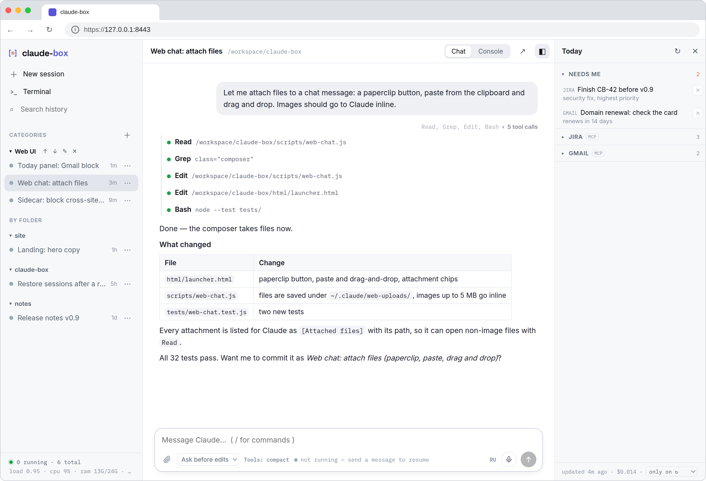
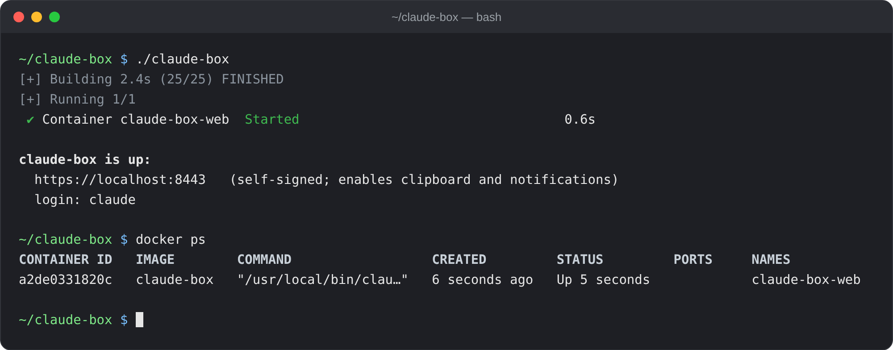

<p align="center">
  
</p>

# claude-box

Isolated execution of **Claude Code** in Docker: access to a single folder only (`/workspace`),
with state and plugins preserved between runs.

<p align="center">
  
</p>

## Running

```bash
./claude-box            # build (cached) and start the web UI, print its address
./claude-box --status   # is it running, where, which console sessions
./claude-box --stop     # stop it (running sessions come back on the next start)
./claude-box --restart  # rebuild (cached) and recreate the container
./claude-box --setup    # re-run the first-run setup
./claude-box --install  # print how to add claude-box to PATH (changes nothing)
./claude-box --env work # another box from .env.work (own home-work/, name, ports); combines with the above
```

<p align="center">
  
</p>

claude-box is a web UI: open the printed address (`https://localhost:8443`, which also enables clipboard
and notifications) and work with Claude in the browser — as a chat or in a real terminal.
The old `--web` / `--build` flags are still accepted and do the same as a plain `./claude-box`.

**First start.** `claude-box` asks one question in the terminal:

1. creates `.env` from `.env.example` if there is none (tokens and the rest live there);
2. asks for the **projects folder** — the host folder with your projects, mounted as `/workspace`
   (default `workspace/` next to the script, git-ignored, created if missing) and saves it as `PROJECT_DIR`;
3. prints a **one-time sign-in link** (`https://localhost:8443/?key=…`, valid 15 minutes, works once),
   plus the same key on plain http (`http://localhost:7681/?key=…`): the https one uses a self-signed
   certificate the browser warns about until you trust it, the http one has no warning (localhost is a
   secure context either way, so clipboard and notifications work on both). Open either: the browser is signed in, and a setup wizard walks through four steps:
   - **Login** (required): a login and password for your phone, other computers and the public tunnel;
   - **Model**: **Sign in with Claude** runs `claude auth login` in the box: open claude.ai, sign in,
     paste back the code it shows. Or pick GLM / Abliteration and paste an API key;
   - **GitHub**: the same device code as `gh auth login --web`;
   - **Jira**: the Atlassian sign-in for New session.
   Everything but the login can be skipped and done later in Settings.

Every start prints a fresh link; `./claude-box --login` prints one without restarting anything.

**Docker on the host** (test stacks: redis, postgres, `docker compose up`): `./claude-box --docker` lets the
box use the host's Docker (`--no-docker` takes it away; the first run asks). The box gets the `docker`
and `docker compose` CLIs and the host's socket — root-equivalent on that machine, so only where
everyone using the box is trusted. Containers started from the box run next to it, not inside: their
published ports are at `host.docker.internal:<port>` from the box, and bind mounts need host paths.
On macOS with Colima, set `docker: {ip: 127.0.0.1}` in `~/.colima/default/colima.yaml`
(then `colima restart`) so `-p 6379:6379` publishes on the Mac's 127.0.0.1 only, not on every network.

**VS Code** (`./claude-box --vscode`): that start builds the image with code-server (about 560 MB
more) and every session gets a **VS Code** tab next to Chat / Console / Terminal / Files: VS Code opened
on the session's folder (for a task, all its repo worktrees). Switching sessions switches the editor;
the last three stay loaded, and VS Code follows the light/dark theme. code-server starts on the first click, listens on a private unix socket
(no port) and is served at `/code/` behind the claude-box login. Claude Code and GitLens extensions
are installed on its first start. The flag is not remembered: a start without it has no VS Code.

**Artifacts**: ask for a design, mockup, chart or report and Claude writes one HTML file in the
session's `.artifacts/` and calls `show_artifact` (the box's own MCP server, `scripts/cb-mcp.js`). The
chat gets a card, and the page opens in a panel on the right: every call is a version (v1, v2, …), the
latest reloads when the file changes, ⤢ widens it, ↗ opens it in a tab. Everything stays in the box
(nothing goes to claude.ai) and works with any model. The page is served from `/artifact/f/…` in a CSP
sandbox: it runs its scripts but cannot read the box's cookies or call its API. Drag the panel's left
edge to resize it (kept per browser; double-click resets).

**Browser** (`./claude-box --browser`): that start builds the image with Chromium (a virtual display,
x11vnc and noVNC; a few hundred MB more) and every session gets a **Browser** tab: one Chromium for the
whole box, shown live, where you click, type and sign in like in any browser. The profile (logins,
cookies) is kept in `home/.config/claude-box-browser`, so a login survives restarts and serves every
session. Claude drives the same browser with its `playwright` tools (pointed at it with
`--cdp-endpoint`); while it does, the tab shows a pill with **Stop Claude**. The screen goes through
`/browser/` behind the claude-box login (VNC on a private unix socket, no port). Chromium keeps its own
sandbox: `docker-compose.browser.yml` runs the box with `seccomp-browser.json`, Docker's default profile
plus one rule for the namespaces it needs. Hardware keys (YubiKey, passkeys) do not reach it; sign in
with a password and a code. The screen follows the tab's size (no black bars, 1:1), and sites see
Google Chrome on Linux: the user-agent string already says Chrome, and the client hints list "Google
Chrome" next to "Chromium" (`CB_BROWSER_BRAND=0` turns that off; Google ships no Chrome for Linux on
ARM, so the real one cannot be installed on an Apple Silicon Mac). Its DevTools port is on 127.0.0.1 inside the container: in the Linux host
network mode that is the host's loopback, so other local users of that host could reach it. Like
`--vscode`, the flag is not remembered. On a Mac, Cmd works as Ctrl there (Cmd+C / V / A / L…), Cmd and
Option with the arrows and Backspace move and delete like on the Mac, held keys repeat, and the
clipboard goes both ways.

**Context strip**: under the session's header, the pull requests, Slack threads and Jira issues the
session deals with: links anywhere in its transcript, plus a task folder's issue and the PRs of its
branches. A PR shows `repo#number`, open / draft / merged, CI, review and comments; a Slack thread its
channel and author; a Jira issue its status (Slack and Jira details come from the Today panel). One
line while there is at most one of each, a line per kind once there are more. A click, or a click on
such a link in the chat, opens it in the Browser tab (a PR or issue in its own tab, Slack in one tab),
or in a new tab of your browser without `--browser`.
The login and password can be changed later in **Settings → Access**; they are kept as a scrypt hash
in `home/.claude/web-auth.json`. An older `WEB_TERMINAL_PASSWORD` in `.env` still works until one is
set in the UI. `--tunnel` refuses to start until a login exists.

Later starts ask nothing; `./claude-box --setup` asks for the folder again. Without a terminal (a script,
CI) it does not ask: a missing `.env` or projects folder is an error with a hint.

To call `claude-box` from anywhere, add it to PATH (`./claude-box --install` shows how).

## What's already set up inside

- **Claude authentication** — **Sign in with Claude** in the setup wizard or Settings (credentials stay in `./home/.claude`), or `CLAUDE_CODE_OAUTH_TOKEN` in `.env` (obtained via `claude setup-token`; used first when set), or a GLM / Anthropic-compatible provider (see [Several model providers](#several-model-providers-claude-glm-abliteration)).
- **Settings** — the host's `settings.json` is copied (auto mode, theme, etc.).
- **superpowers plugin** — lives in `home/.claude/plugins/`, active right away.
- **MCP servers** — user-scope, seeded from `claude-defaults/mcp.json` into `~/.claude.json` at startup: `atlassian`, `github`, `sentry`, `context7`, `kubernetes`, `figma`, `playwright`, `grafana`. Remote ones (`atlassian`/`sentry`/`figma`) are authorized once via `/mcp`; `github` takes `GH_TOKEN`, `context7` takes `CONTEXT7_API_KEY`, `grafana` takes `GRAFANA_URL`+`GRAFANA_SERVICE_ACCOUNT_TOKEN` from `.env`. A server `url` in `mcp.json` may use `${VAR}` / `${VAR:-default}` from `.env` (filled in at startup).
- **git** — identity set in `home/.gitconfig`.
- **Skills** — skills shipped with the box live in `claude-defaults/skills/<name>/` and are copied into `~/.claude/skills/` on every start, so every box gets them and an image update brings new versions. Each copy holds a `.claude-box-managed` marker; delete it to keep your own edits (the box then leaves that folder alone). A skill of the same name that you made yourself (no marker) is never touched. Included: **`/pr-review <PR url | number> [--level high|xhigh|max] [--no-run] [--refresh-habits]`** — a full pull request review: it reads every project rule (`CLAUDE.md` files, `.claude/`, `AGENTS.md`, contributing, lint and CI config), checks PR hygiene (AI co-author trailers, history, behind base / conflicts, draft state, issue key in the title), runs the project's own typecheck / lint / tests for the changed files (comparing failures against the base), runs `code-review` plus three agents — project-rules compliance, "does it do what the issue asks and what does the rollout need" (env vars, flags, migrations, deployment config PRs, release order), and the team reviewers' recurring remarks (learned from ~90 days of their reviews, cached in `~/.claude/review-habits/` for 14 days) — re-verifies every finding with independent agents, and reports in your language. It publishes review comments or approves only when you say so. **`/pr-feedback <PR> [--ready]`** — the other side: works through the remarks on your own PR (unresolved threads, review summaries, bot comments, failing CI), verifies each against the code, proposes fix / reply / decline with a short reply, then fixes, runs the checks and self-reviews the fixes; it pushes, replies in the threads and re-requests review only on your command, and with `--ready` gets the PR ready to merge (rebase, clean history, description, draft off). **`/pr-release-plan <PRs | issue key> [status]`** — a release checklist from merge to verified on production: env vars and flags per environment, migrations and backfills, deployment config PRs, services that must ship first, sync/restart steps, code freeze; each step with an owner, a concrete verification and a rollback, plus drafts for the people who must act. It saves `RELEASE-PLAN.md` in the task folder and on later calls re-checks the real state (merged, deployed version, flag values) and says what is next. It never merges, deploys or runs SQL itself. **`/jira-check <ISSUE-KEY> [--repo …] [--quick]`** — takes an issue apart before work starts: the issue in full (comments, epic, sub-tasks, linked issues, attachments, linked specs), the related PRs and discussion, a map of the code involved and its history, a harmless reproduction (tests, dev requests, read-only queries); then a verdict (real and needed / works as designed / duplicate / obsolete / unclear) with evidence and a plan — approach, files, tests, API/docs, data/config, split, risks, size, open questions, how to verify. Saves `ANALYSIS.md` in the task folder; posts to Jira or starts coding only on your command. **`/pr-watch`** — an automatic reviewer for other people's PRs. Run it in its own session in a folder that holds clones of the repos to watch (e.g. `/workspace/reviews/api`, `/workspace/reviews/web`): it loops every few minutes, and for each new PR or new commits it starts a separate session running `/pr-review --auto`, then posts the confirmed critical/high findings as a COMMENT review (never twice, never on a commit it did not review) and lists the PRs that are ready to approve. It approves only when you tell it to in that session (`approve api#2261`). PRs open at the start are a baseline and are not reviewed unless they get new commits; `.pr-watch/config.json` sets the limits (parallel reviews, reviews per day, only PRs where your review is requested, which severities to post, report-only). State and the per-PR clones live in `.pr-watch/`; the Today panel shows each PR's review status when the folder is `/workspace/reviews`.
- **Completion signals** — when Claude finishes a response (or is waiting for input/permission), a bell rings and the tab title changes to `✅/❓/⏳ <session>`; from another tab you can see which Claude has become free. To disable — `CLAUDE_NOTIFY_DISABLE=1` in `.env` (hooks already seeded remain until you manually clear `home/.claude/settings.json`).
- **Web terminal (Console)** — the in-browser terminal is ttyd on `127.0.0.1:7682`, behind the same port and login as the rest of the UI; it opens a picker of tmux sessions (different tabs = different claude sessions, which survive closing the tab; a new one asks for its folder). Port / login / password — `WEB_TERMINAL_PORT` / `WEB_TERMINAL_USER` / `WEB_TERMINAL_PASSWORD` in `.env`. Several concurrent sessions share `~/.claude.json` (a shared `./home`); simultaneous active work in the same folder/session from different tabs is not recommended.
- **Several boxes on one machine** — each env file is one box: `.env` by default, or `.env.NAME` with `./claude-box --env NAME` (`--env .env.NAME`, `--env path/to/file` and `CLAUDE_BOX_ENV=NAME` work too; every other flag combines with it, e.g. `./claude-box --env work --restart`). Each box has its own home — `home/` for `.env`, `home-NAME/` for `.env.NAME` (`BOX_HOME` in the env file overrides) — so its own sessions, history and login. Boxes share a docker daemon (several env files, two checkouts, two users of one Mac) only with their own names and ports: set `CLAUDE_BOX_NAME` (container `<name>-web`, image `<name>`, compose project `<name>`), `WEB_TERMINAL_PORT`, `WEB_TLS_PORT` and `TTYD_PORT` in each box's env file. When `claude-box` creates `.env.NAME` from the template it asks for them (`.env` only when another box is already there), and it refuses to start or stop a same-named container that another checkout or another env file owns. All `.env*` files but `.env.example` are git-ignored.
- **Web chat (HTML mode)** — the launcher shows a Claude Code-style sidebar of sessions grouped by folder. Each session opens as a native web chat by default: messages stream in over a WebSocket (`/chat/ws`), Markdown/code render as real HTML (select and copy normally), tool calls show as collapsible rows with their results and diffs, and permission requests / Claude's questions appear as buttons. Under the hood the sidecar drives Claude through the **Claude Agent SDK** (`scripts/web-chat.js`), on the same session files as the CLI. The **Chat / Console** switch in the top bar hands the same session over to the classic terminal (`claude --resume` in tmux, for slash commands and anything TUI-only) and back — one owner at a time, so switching to the console stops the chat process and switching back closes the console. New sessions start from a folder picker; the classic console menu is still one click away. Idle chat processes stop after `WEB_CHAT_IDLE_MINUTES` (default 60) and resume on the next message. Files can be attached with the paperclip, by pasting (e.g. a screenshot) or by dropping them on the chat (up to 20 files / 30 MB per message): they are saved under `~/.claude/web-uploads/` (override with `WEB_CHAT_UPLOADS`), images are also sent inline, and every file is listed by path so Claude can read it. Typing `/` in the composer lists the slash commands and skills of that folder with their descriptions and argument hints (↑/↓, Enter or Tab to pick); the list comes from Claude itself and is cached in `~/.claude/web-commands.json`. The **Tools:** button in the composer folds tool calls into one line per run (compact), shows them all, or hides them. Self-paced loops survive restarts: on startup the sidecar finds chat sessions whose last `ScheduleWakeup` was not a stop and re-sends its prompt when the wakeup is due (`WEB_RESUME_LOOPS=0` disables, `WEB_RESUME_LOOPS_MAX_HOURS` — default 12 — limits how old a loop may be).
- **Workspace — a file manager** — **Workspace** in the sidebar browses `/workspace`: click a folder to go in (breadcrumbs and the browser's Back button go up), click a file to open it in a tab (text, images, PDF; anything else downloads). **Start session** (on hover, or **Start session in this dir** for the open folder) starts Claude in that folder. A folder with sessions shows a sessions button (count, and a dot for the one that needs you most); it opens the list of them and **New session here**. The **Size** column shows folder sizes as well, counted with `du` in the background (each folder has a time limit, results are cached for a few minutes). **Clone from Git** lists the repos your GitHub account can reach (own, shared, your organizations'), searchable as you type; a pasted URL works too. Drop files — or whole folders — from your computer onto the list or onto a folder to upload them (no size limit by default, `WEB_UPLOAD_MAX_MB` sets one; existing names are asked about), or use **Upload**. Drag rows onto a folder or a breadcrumb to move them (⌥/Alt copies); select several with the checkboxes, ⌘/Ctrl-click or Shift-click, then Copy / Cut and **Paste here** in another folder, Rename, Download or Delete (⌫ with ⌘/Ctrl, or Delete). Delete moves things to `/workspace/.trash/<time>/`, so they can be restored. Dotfiles are listed too. Every path is confined to the workspace (no `..`, no symlinks out of it).
- **New session — one folder per task** — **New session** in the sidebar opens a dialog with three fields. *Session name*: how the session is called in the sidebar (it is also the task's title and folder name, and is written into the session like a rename, so Claude's generated title does not replace it). *Jira issue* (optional): your issues in work (from the Today panel), recent issues of your projects, and all of Jira as you type (a short read-only run through the Jira connector); ↑↓ and Enter pick; picking one fills an empty name with its title; or **Create a new Jira issue** (the session creates it first thing). *Repositories*: a field that opens a searchable list with checkboxes — the selected ones first, then the repos already in the workspace, then everything your GitHub account can reach; the list scrolls inside the dialog and its group headers stay on top. **Start session** creates `/workspace/tasks/<KEY-title>/` with a `.task.json` (id, title, link, branch), a generated `CLAUDE.md` (the task's repos, branches and rules) and a **git worktree** of each repository on a branch named after the task. Repositories are cloned once into `/workspace/repos/` — mirrors that nobody works in, fetched every 15 minutes (`WEB_REPOS_SYNC_MIN`; the default branch is fast-forwarded when nothing is changed there) — and every task works in its own worktree, so several tasks can change the same repository at once on different branches and pull requests. The session runs in the task folder with each repository added as an extra directory, so every repository's `CLAUDE.md` and `.claude/skills` load; a repository added later (task menu → **Add repo**) joins with the next message. For a Jira issue the message box gets `/jira-check <KEY> --repo …` (you send it); otherwise a short brief. Status dots show what is safe to clean up: uncommitted changes, commits not pushed, or nothing unsaved. **Archive** removes the worktrees (the branches stay in the base repos, the folder keeps `.task.json`, sessions stay), **Reopen** makes the worktrees again, **Forget** removes an archived task's folder. Worktrees hold absolute paths, so task folders are meant to be used inside the box; tasks made by older versions keep their plain clones. **New temp session** starts a throwaway chat in a fresh `/workspace/tmp/<date-time>/`. A link opens or creates a task from anywhere (a task tracker, a bookmarklet, Slack): `/?task=PROJ-123&title=…&url=…&repos=api,specs` — a Jira-style key becomes the id and branch prefix; any other id (e.g. `tracker:<id>`) works too. A link to a task that does not exist yet and has no `repos=` opens a prefilled form, so the repos are picked on the server itself.
- **Today panel (right)** — the ◧ button in the top bar opens a panel that gathers the day in one place. **Needs me** on top: 3–5 items where you have to act (a question in Slack, a review requested from you, your PR with failing CI or changes requested, a meeting about to start, a blocking Jira issue), plus live ones — sessions waiting for your answer and meetings starting within 15 minutes. Below, collapsible: **Calendar** (the rest of today), **GitHub** (review requests addressed to you, those that came through a team, and your open PRs with CI state, review decision and a dot for new activity; PRs checked by the PR reviewer show its status), **Jira** (your issues that are not done — a click opens or creates the task workspace), **Slack** (mentions, thread replies and DMs of the last 24 hours) and **Gmail** (unread mail from people, no notifications). Each block shows only when its source is connected (the MCP connector exists; GitHub: `gh` is logged in). **✕** on an item hides it until something about it changes — a draft PR comes back when it is ready for review or its CI / review state changes, a Jira issue when its status changes, a meeting when it moves; "N hidden · show" lists them to bring one back. Hidden items are kept on the server (`~/.claude/web-panel-hidden.json`), so every browser sees the same. GitHub comes straight from `gh` (refreshed every minute). Calendar, Jira, Slack and Gmail come through Claude's MCP connectors: a short **read-only** run on a cheap model (`WEB_PANEL_MODEL`, default `claude-haiku-5-5`; any MCP call that is not a read is refused) collects them and picks the "Needs me" items, on ↻ and on the interval picked at the bottom of the panel (5 min … 1 h, or only on ↻; `WEB_PANEL_MINUTES`, default 15, is the initial value) while the panel has been opened in the last two hours. A run takes about a minute and costs a few cents of usage. `WEB_PANEL=0` turns the agent part off. The snapshot is kept in `~/.claude/web-panel.json`.
- **Sessions started by an agent (`cb-session`)** — inside the box, `cb-session new --cwd DIR --prompt TEXT [--title T] [--mode auto] [--category NAME]` starts a chat session that works on its own and prints its token; `cb-session status TOKEN` reports its state (`running`, `requires_action`, `idle`, …), cost and last answer. They are ordinary chat sessions — listed in the sidebar (filed under `--category` if given), open and continue like any other. This is how one agent can hand work out to many sessions, e.g. a reviewer that starts one session per pull request. Backed by `POST /chat/api/new` and `GET /chat/api/status?token=` (same login as the UI).
- **Sessions survive a container restart** — the web container keeps the list of running sessions on disk (`home/.claude/web-live-sessions.json`, refreshed every 15s and on shutdown). On the next start every one of them is brought back automatically (`claude --resume` in its original folder, same tmux name), so the launcher shows them live again. The web service also has `restart: unless-stopped`, so it comes back by itself after a Docker/host restart. A session is remembered once Claude has fired its first hook in it (i.e. after the first prompt). Set `WEB_RESTORE_SESSIONS=0` in `.env` to turn this off.

## Tests

macOS and Linux are separate runs, and both must pass:

```bash
bash tests/run.sh               # every suite on this machine (macOS or Linux)
bash tests/run.sh --linux       # every suite on Linux, inside the test box's image (.env.test: ./claude-box --env test)
```

The Linux run is where the web server really lives (tmux, `/proc`); the host run checks `./claude-box`
against the host's own tools (BSD userland on macOS). Suites that need a tool the host lacks (tmux) skip.
The suites on their own:

```bash
node --test tests/*.test.js     # web server modules: registry, search, preview, metrics, startup
bash tests/web-menu.test.sh     # console deep links / resume (needs tmux, jq)
bash tests/claude-box.test.sh   # host entry point: first-run setup, docker calls (docker is stubbed)
```

---

## Running on macOS

Works out of the box: `./claude-box` detects Docker Desktop and switches the network mode to
explicit port mapping (`WEB_BIND=ports`), so the UI opens at `https://localhost:8443` on the Mac.
No plugins needed. On Linux (and WSL2) nothing changes — the container keeps sharing the host
network directly.

Caveat of the mapped mode: the container cannot reach services bound to the Mac's `127.0.0.1`
(Tailscale socket, local databases). Address those via `host.docker.internal`, the LAN or the
tailnet IP. Force a mode explicitly with `WEB_BIND=ports` or `WEB_BIND=host` in `.env`
(host networking on macOS requires an engine with real host support, e.g. OrbStack).

---

## Several model providers: Claude, GLM, Abliteration

claude-box can keep several Anthropic-compatible providers connected at once and let every chat pick
its own model. **Settings → Models**:

- **Claude** — **Sign in with Claude** (`claude auth login` in the box) or `CLAUDE_CODE_OAUTH_TOKEN` in `.env`;
- **GLM via z.ai**, **Abliteration** — paste the API key;
- **Custom endpoint** — any Anthropic-compatible base URL, model name and key;
- **Default for new sessions** — also used by console (tmux) sessions.

Keys stay inside the box in `home/.claude/web-providers.json` (mode 600); the UI only shows their
last four characters. In a chat, the model button next to the status (e.g. `Opus 5.5 ▾`) switches the
model: within Claude it changes right away; another provider restarts the session's process with that
provider's key and resumes the same conversation (not while an answer is running). Other providers do
not support everything Claude does, so a long Claude conversation may not carry over cleanly.
Inbox, Today and the Jira search always run on Claude.

The older way still works: a provider block in `.env` applies to the whole box and shows up in
Settings as connected "from .env":

```env
ANTHROPIC_BASE_URL=https://api.z.ai/api/anthropic
ANTHROPIC_AUTH_TOKEN=<your z.ai key>
ANTHROPIC_DEFAULT_SONNET_MODEL=GLM-5.3-Flash
ANTHROPIC_DEFAULT_OPUS_MODEL=GLM-5.3-Flash
ANTHROPIC_DEFAULT_HAIKU_MODEL=GLM-5.3-Flash
```

A provider kept in `home/.claude/settings.json` `"env"` by an older version is moved into
Settings → Models on the first start.

---

## How to get a `GH_TOKEN` (for `gh` — creating PRs, etc.)

`gh` (GitHub CLI) requires a token to work. The simplest way is to set it via the
`GH_TOKEN` variable in `.env` (it's picked up automatically, so `gh auth login` isn't needed).
The easier way is **Connect GitHub** in the UI (first visit or Settings → GitHub): it runs `gh auth login --web`
for you, shows the code to enter at github.com/login/device, and fills in the commit name and email.
Who the box commits as is filled in by itself: the host's git name and email (`./claude-box` copies
them into `.env` as `GIT_USER_NAME` / `GIT_USER_EMAIL` once), else the GitHub account's; change it in
**Settings → GitHub**. A rule in `/etc/claude-code/CLAUDE.md` makes Claude ask when there is none,
never borrow an author from a repository's history.

### Classic token

1. **GitHub → Settings → Developer settings → Personal access tokens → Tokens (classic)**
   → **Generate new token (classic)**.
   Direct creation link: <https://github.com/settings/tokens/new>
   (list of all tokens: <https://github.com/settings/tokens>).
2. **Note** — a name (e.g. `claude-box`), **Expiration** — the lifetime.
3. Check the scopes:
   - ✅ **`repo`** — the whole block (Full control of private repositories). This is enough: pushing branches + creating PRs.
   - Everything else (read:org, workflow, packages, admin, gist, user, delete_repo, etc.) is **not needed** — leave it unchecked.
4. **Generate token** → copy it (it starts with `ghp_…`).
5. If your organization has SSO enabled — click **Enable SSO / Authorize** next to the token.

### Set the token

Open `.env`, uncomment the line and paste the token:

```env
GH_TOKEN=ghp_xxx
```

Restart claude-box (`./claude-box --restart`) — and `gh` is ready:

```bash
# in the web terminal:
gh auth status     # should show "Logged in ... (GH_TOKEN)"
gh pr create ...
```

> Alternative without `GH_TOKEN`: run `gh auth login` once inside the container —
> the authorization is saved in `home/.config/gh` and survives restarts.

### Token security

- The token lives in `.env` (permissions `600`) — this file **must not be committed** or shown.
- Use minimal permissions and a shorter lifetime.
- If the token leaks — revoke it on the same GitHub page and generate a new one.

---

## Connecting to JIRA (Atlassian MCP)

Jira/Confluence connect via Atlassian's official remote MCP server.

Authorization — **once**:

1. Start claude-box (`./claude-box`) and open a session in the **Console** (the terminal).
2. In Claude type `/mcp` → choose **atlassian** → **Authenticate**.
3. Claude will show an OAuth link — open it in a browser, log in to Atlassian, grant access.
4. The authorization is saved in the passed-through `home/` (`~/.claude`) — no need to log in again on restarts.

**Check:** `/mcp` shows `atlassian — connected`; you can ask Claude to search/read/comment on Jira issues.
